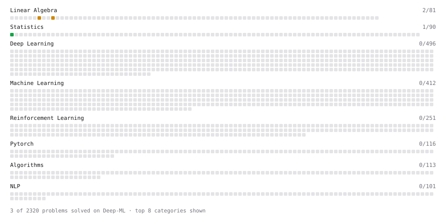

# Deep-ML

My machine learning practice from [Deep-ML](https://www.deep-ml.com). Every solution here was written by hand.

**2** solved · 2 problems · 0 labs · 0 math

[**Browse the interactive portfolio**](https://Madhav089-web.github.io/deep-ml/) to replay this filling in over time.

## Problems

| | Difficulty | Solved | |
| --- | --- | --- | --- |
| [Calculate Covariance Matrix](https://www.deep-ml.com/problems/10) | easy | 2026-11-17 | [solution](problems/0010-calculate-covariance-matrix) |
| [Matrix Transformation ](https://www.deep-ml.com/problems/7) | medium | 2026-11-17 | [solution](problems/0007-matrix-transformation) |

---

_This file is regenerated by Deep-ML on every push._
